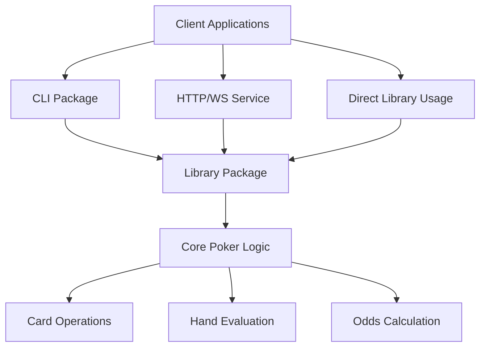
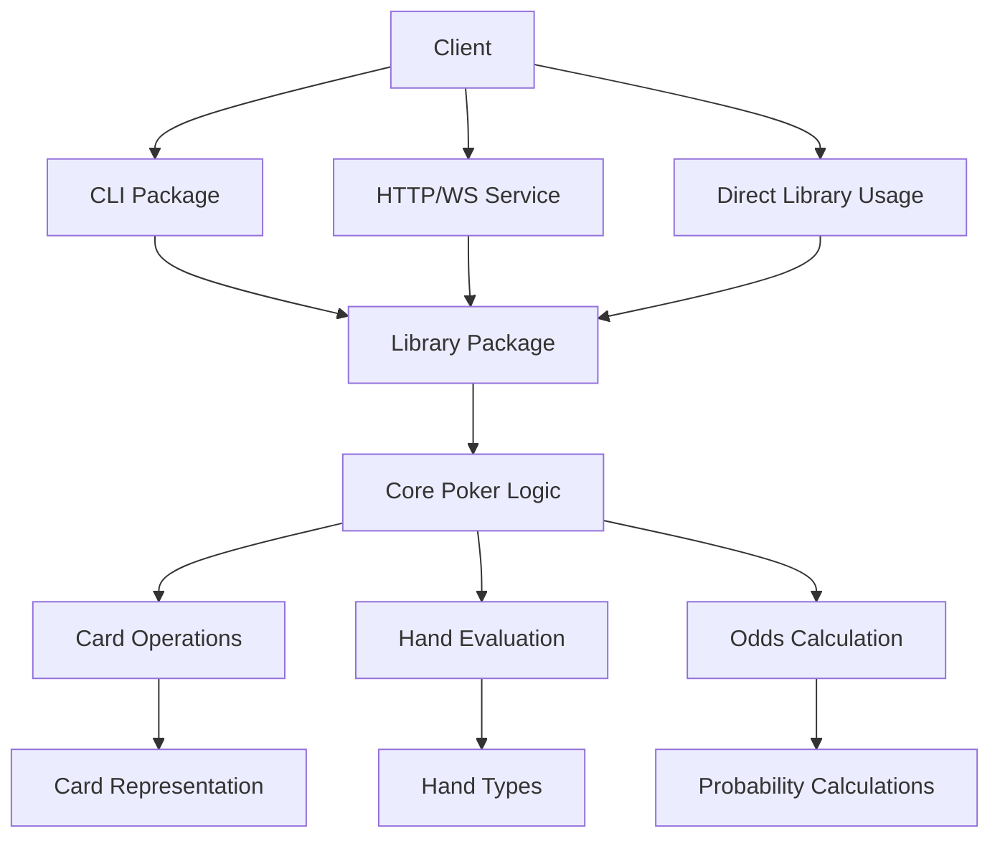

# Poker Hands

[](https://www.npmjs.com/package/@malte.muth/poker-hands)
[](https://www.npmjs.com/package/@malte.muth/poker-hands-service)
[](https://www.npmjs.com/package/@malte.muth/poker-hands-cli)
[](https://github.com/malte-muth/poker-hands/actions/workflows/ci.yml)

A comprehensive TypeScript monorepo for Texas Hold'em poker hand evaluation, odds calculation, and more. This project provides three packages: a core library, an HTTP/WebSocket service, and a command-line interface.

## 📦 Monorepo Structure

This project is organized as a monorepo with three main packages:

```
poker-hands/
├── packages/
│   ├── library/          # Core poker logic library
│   ├── service/          # HTTP/WebSocket service
│   └── cli/             # Command-line interface
├── package.json         # Workspace configuration
└── README.md            # This file
```

### Package Overview

| Package                                                           | Description                                   | Installation                                  |
| ----------------------------------------------------------------- | --------------------------------------------- | --------------------------------------------- |
| **[@malte.muth/poker-hands](packages/library/README.md)**         | Core poker hand evaluation library            | `npm install @malte.muth/poker-hands`         |
| **[@malte.muth/poker-hands-service](packages/service/README.md)** | HTTP/WebSocket service for poker calculations | `npm install @malte.muth/poker-hands-service` |
| **[@malte.muth/poker-hands-cli](packages/cli/README.md)**         | Command-line interface for poker calculations | `npm install -g @malte.muth/poker-hands-cli`  |

## 🚀 Quick Start

### Prerequisites

- Node.js >= 24.6.0 (see [`.nvmrc`](.nvmrc))
- npm >= 10.8.2

### Workspace Installation

```bash
# Clone the repository
git clone https://github.com/malte-muth/poker-hands.git
cd poker-hands

# Install all dependencies
npm install

# Build all packages
npm run build

# Run all tests
npm test
```

## 📋 Package Features

### Library Package (`@malte.muth/poker-hands`)

- **Hand Evaluation**: Determine the best possible poker hand from any set of cards
- **Hand Comparison**: Compare two poker hands to determine which is better
- **Odds Calculation**: Calculate winning probabilities for given hole cards and board
- **Hand Percentages**: Calculate the probability of making each hand type
- **Card Manipulation**: Create, shuffle, and manipulate poker decks and cards
- **TypeScript Support**: Full type safety with comprehensive TypeScript definitions

### Service Package (`@malte.muth/poker-hands-service`)

- **REST API**: HTTP endpoints for all poker calculations
- **WebSocket Support**: Real-time poker calculations for live scenarios
- **Request Validation**: Input validation and error handling
- **CORS Support**: Cross-origin resource sharing enabled
- **Express.js**: Built on Express for robust API development

### CLI Package (`@malte.muth/poker-hands-cli`)

- **Command-line Interface**: Easy-to-use CLI for poker calculations
- **Multiple Commands**: Support for best hand, comparison, odds, and percentages
- **Flexible Input**: Accept cards in various formats
- **Formatted Output**: Clean, readable output for all commands
- **Global Installation**: Install and use from anywhere in your terminal

## 🏗️ Architecture

The project follows a clean architecture with clear separation of concerns:



For detailed architecture diagrams, see [ARCHITECTURE_DIAGRAMS.md](ARCHITECTURE_DIAGRAMS.md).

### Overall Repository Structure

```mermaid
graph TD
    A[poker-hands/ (Root Workspace)] --> B[package.json (workspace config)]
    A --> C[.gitignore]
    A --> D[tsconfig.json (workspace)]
    A --> E[README.md]

    A --> F[packages/]
    F --> G[library/]
    F --> H[service/]
    F --> I[cli/]

    G --> G1[package.json]
    G --> G2[src/]
    G --> G3[__tests__/]
    G --> G4[dist/]

    H --> H1[package.json]
    H --> H2[src/]
    H --> H3[dist/]

    I --> I1[package.json]
    I --> I2[src/]
    I --> I3[dist/]
```

### Data Flow Architecture



### API Endpoints

```mermaid
graph TD
    A[HTTP/WS Service] --> B[REST API]
    A --> C[WebSocket]

    B --> D[POST /api/best-hand]
    B --> E[POST /api/compare]
    B --> F[POST /api/odds]
    B --> G[POST /api/percentages]

    C --> H[/ws endpoint]
    H --> I[Real-time calculations]
    H --> J[Hand evaluation]
    H --> K[Odds updates]
```

### CLI Commands

```mermaid
graph TD
    A[poker-hands CLI] --> B[best-hand]
    A --> C[compare]
    A --> D[odds]
    A --> E[percentages]

    B --> F[poker-hands best-hand <cards...>]
    C --> G[poker-hands compare <hand1> <hand2>]
    D --> H[poker-hands odds <hole1> <hole2> [board...]]
    E --> I[poker-hands percentages <hole1> <hole2> [board...]]
```

## 📖 Documentation

- [Library Documentation](packages/library/README.md) - API reference and usage examples
- [Service Documentation](packages/service/README.md) - API endpoints and WebSocket usage
- [CLI Documentation](packages/cli/README.md) - Command-line interface usage
- [Architecture Diagrams](ARCHITECTURE_DIAGRAMS.md) - Visual representation of the system
- [Migration Guide](MIGRATION.md) - Migrate from old single-package structure

## 🔧 Development

### Working with Individual Packages

```bash
# Build a specific package
npm run build:library
npm run build:service
npm run build:cli

# Test a specific package
npm run test:library
npm run test:service
npm run test:cli

# Lint a specific package
npm run lint:library
npm run lint:service
npm run lint:cli
```

### Development Workflow

1. Make changes to any package
2. Run tests: `npm test`
3. Build packages: `npm run build`
4. Commit changes

## 🔧 Advanced Development Setup

### Prerequisites

- Node.js >= 24.6.0 (use `nvm use` to activate the correct version)
- npm >= 10.8.2
- Git
- Code editor (VSCode recommended with TypeScript extensions)

### Initial Setup

```bash
# Clone the repository
git clone https://github.com/malte-muth/poker-hands.git
cd poker-hands

# Install Node.js version specified in .nvmrc
nvm install
nvm use

# Install all dependencies
npm install

# Build all packages
npm run build

# Run all tests to ensure everything works
npm test
```

### Working with Individual Packages

```bash
# Navigate to a specific package
cd packages/library
cd packages/service
cd packages/cli

# Build a specific package
npm run build

# Test a specific package
npm test

# Run tests in watch mode
npm run test:watch

# Lint code
npm run lint

# Clean build artifacts
npm run clean
```

### Development Environment Setup

#### VSCode Setup

1. Install recommended extensions:

   ```bash
   code --install-extension ms-vscode.vscode-typescript-next
   code --install-extension esbenp.prettier-vscode
   code --install-extension ms-vscode.vscode-json
   ```

2. Create a `.vscode/settings.json` file:
   ```json
   {
     "typescript.preferences.preferTypeOnlyAutoImports": true,
     "editor.formatOnSave": true,
     "editor.defaultFormatter": "esbenp.prettier-vscode"
   }
   ```

#### Git Hooks

The project includes pre-commit hooks for code quality:

```bash
# Install git hooks
npm install --save-dev husky lint-staged
npx husky install
npx husky add .husky/pre-commit "npx lint-staged"
```

### Testing Strategy

```bash
# Run all tests
npm test

# Run tests with coverage
npm run test:coverage

# Run tests in watch mode
npm run test:watch

# Run specific package tests
npm run test:library
npm run test:service
npm run test:cli

# Run full integration tests
npm run test:full

# Run performance tests
cd packages/library && npm run test:perf
```

### Building and Publishing

```bash
# Build all packages
npm run build

# Build specific packages
npm run build:library
npm run build:service
npm run build:cli

# Clean all build artifacts
npm run clean

# Publish packages (requires npm access)
cd packages/library && npm publish
cd packages/service && npm publish
cd packages/cli && npm publish
```

### Debugging

#### Debugging Tests

```bash
# Debug specific test file
node --inspect-brk node_modules/.bin/jest --runInBand --testPathPattern=your-test-file

# Debug with VSCode
# 1. Open VSCode
# 2. Go to Run and Debug
# 3. Select "Jest Test Debugger" configuration
# 4. Set breakpoints in your test files
```

#### Debugging Applications

```bash
# Debug the service
cd packages/service
npm run dev

# Debug with VSCode
# 1. Open VSCode
# 2. Go to Run and Debug
# 3. Select "Node.js: Attach to Process" configuration
# 4. Set breakpoints in your source files
```

### Code Quality

```bash
# Lint all packages
npm run lint

# Lint specific package
npm run lint:library
npm run lint:service
npm run lint:cli

# Fix linting issues
npm run lint:fix

# Type check
npx tsc --noEmit

# Format code
npm run format
```

### Performance Profiling

```bash
# Profile the library
cd packages/library
npm run profile

# Profile the service
cd packages/service
npm run profile

# Generate CPU profile
node --prof service/dist/index.js
```

### Contributing Guidelines

1. **Follow the Code Style**: Use the existing ESLint configuration
2. **Write Tests**: Add tests for new functionality
3. **Update Documentation**: Update README files and inline documentation
4. **Use Type Hints**: Leverage TypeScript for better code quality
5. **Commit Messages**: Follow conventional commits format
6. **Pull Requests**: Create detailed PR descriptions with change justifications

### Troubleshooting

#### Common Issues

1. **Node.js Version Issues**

   ```bash
   # Ensure correct Node.js version
   nvm use
   node --version  # Should show v24.6.0 or higher
   ```

2. **Build Failures**

   ```bash
   # Clean and rebuild
   npm run clean
   npm run build
   ```

3. **Test Failures**

   ```bash
   # Run tests with verbose output
   npm test --verbose
   ```

4. **Dependency Issues**
   ```bash
   # Clear npm cache and reinstall
   npm cache clean --force
   rm -rf node_modules package-lock.json
   npm install
   ```

#### Getting Help

- Check the [Issues](https://github.com/malte-muth/poker-hands/issues) page
- Review the [CONTRIBUTING.md](CONTRIBUTING.md) guidelines
- Join the discussions in GitHub Discussions

## 🧪 Testing

The project uses Jest for testing with comprehensive coverage:

```bash
# Run all tests
npm test

# Run tests in watch mode
npm run test:watch

# Run full integration tests
npm run test:full
```

## 📦 Publishing

Each package can be published independently:

```bash
# Publish library
cd packages/library && npm publish

# Publish service
cd packages/service && npm publish

# Publish CLI
cd packages/cli && npm publish
```

## 🤝 Contributing

Please read [CONTRIBUTING.md](CONTRIBUTING.md) for details on our code of conduct and the process for submitting pull requests.

### Development Guidelines

1. Follow the existing code style and patterns
2. Add tests for new functionality
3. Update documentation for API changes
4. Ensure all tests pass before submitting

## 📄 License

This project is licensed under the MIT License - see the [LICENSE](LICENSE) file for details.

## 🔗 See Also

- [ProPokerTools](http://www.propokertools.com/simulations) - Online poker calculator
- [poker-odds](https://github.com/CookPete/poker-odds) - CLI poker odds calculator

## 🙏 Acknowledgments

This project was inspired by and tested against ProPokerTools and poker-odds. For production poker equity calculations, both tools are strictly better than this one.
